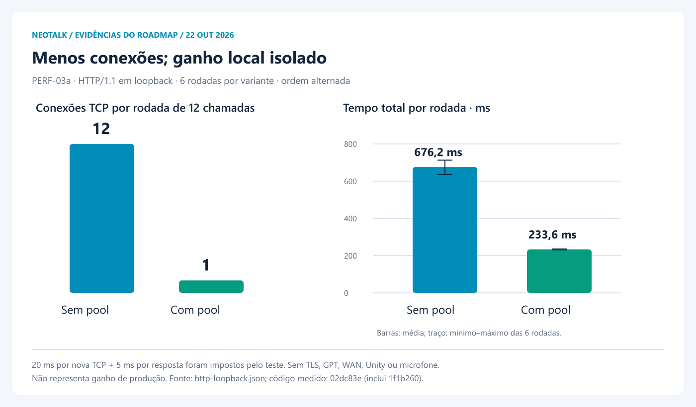
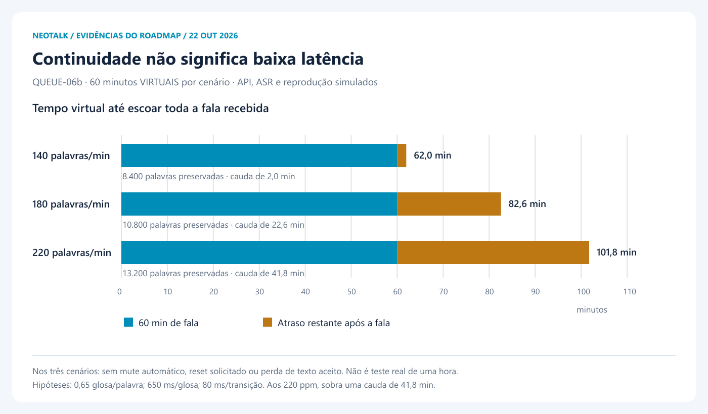
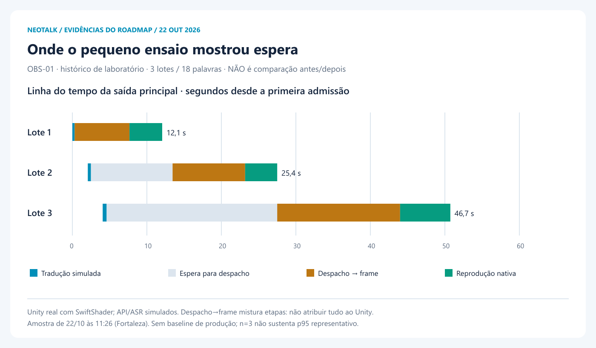

# Evidências de performance — 22/10/2026

**Não há baseline de produção aprovado.** Este painel distingue a melhoria
isolada de HTTP, a continuidade em simulação e um pequeno ensaio nativo antigo.
Não misturar as três populações, somar percentis ou afirmar ganho ponta a ponta.
Nenhum áudio, transcrição, credencial, URL de sessão ou identificador de usuário
está nos dados publicados.

## PERF-03a / PERF-03 — HTTP



Seis rodadas por variante, 12 chamadas distintas em cada uma (144 chamadas no
total), ordem alternada. Ambas usam o código candidato `02dc83e`; a variante
sem lifespan reproduz o transporte temporário anterior. Não é um checkout A/B
completo de versões antigas e novas da plataforma. Inclui criação e fechamento
dos clientes e um contexto frio por variante. Sem reaproveitar respostas.

| Variante | TCP por rodada | Média da rodada | Mín.–máx. |
|---|---:|---:|---:|
| Temporário | 12 | 676,2 ms | 635,7–713,0 ms |
| Pool | 1 | 233,6 ms | 231,0–235,8 ms |

O servidor impõe 20 ms por nova TCP e 5 ms por resposta. Não mede TLS, GPT,
internet, custo, avatar ou microfone. Menos TCP foi observado neste teste;
o percentual de redução não pode ser transferido para produção. A execução
usa o event loop normal, diferente do modo debug do `IsolatedAsyncioTestCase`:
não construir uma série temporal juntando estes tempos com saídas antigas.

[Dados brutos agregados](http-loopback.json) ·
[Benchmark reproduzível](../../../backend/tests/benchmark_http_pool.py)

## QUEUE-06b — continuidade e atraso



Dados dos três testes de 60 minutos **virtuais** documentados em
[QUEUE-06B-VALIDATION](../../QUEUE-06B-VALIDATION-2026-10-22.md).
São cenários de carga diferentes, não uma evolução antes/depois. Texto aceito
preservado e ausência de mute/reset solicitado não demonstram baixa latência.
O modelo ainda deixa 41,8 minutos de cauda a 220 palavras/minuto: esse problema
não está resolvido pelo staging. Falta validação real de uma hora e duas horas.

## OBS-01 — pequeno ensaio com Unity



Três lotes/18 palavras em 22/10 às 11:26, Fortaleza. Unity real nos dois players,
SwiftShader, API/ASR simulados. O gráfico mostra a saída principal e os marcos
observados no navegador. O número no fim da barra é admissão→último frame daquele
lote, não a posição absoluta na linha do tempo. Tradução simulada inclui a espera
admissão→agente; despacho→frame inclui mais de uma etapa. Não atribuir toda essa
parcela ao renderizador. Não é uma nova execução da candidata atual nem prova
de ganho de velocidade. n=3 não sustenta p95 representativo.

[Agregados sem conteúdo de fala](lab-aggregates.json) ·
[Contexto e limitações](../../LIVE-OBSERVABILITY-2026-10-22.md)

## Próximas atualizações

Para cada coleta real: registrar commits da plataforma/widget e hash do WebGL,
navegador/hardware, rede, data/hora, tamanho dos lotes e cache frio/quente.
Separar principal/mini-player. Acompanhar média/p50/p95 com número de amostras,
pausa entre execuções, atraso/idade da fila, pausas do microfone, rejeições,
erros, retentativas, resets e memória. Amostras ausentes continuam ausentes.

Comparar antes/depois com a mesma carga e ambiente; manter evidências históricas
datadas, sem substituir um resultado ruim por um gráfico de outra população.
Gate OBS-01: pelo menos 100 lotes reais e spans internos do worker ainda pendentes.

## Reproduzir os arquivos

No diretório `backend`:

```powershell
python tests/benchmark_http_pool.py --output ../docs/performance/2026-10-22/http-loopback.json --rounds 6
```

Na raiz do checkout, com `sharp` disponível no ambiente (ou variável
`NEOTALK_SHARP_MODULE` apontando para a instalação existente):

```powershell
node scripts/render-performance-evidence.mjs
```

Os SVGs/PNGs são estáticos e produzidos a partir dos dois JSONs versionados.
Não há coleta automática de usuários ou alteração do runtime da plataforma.
