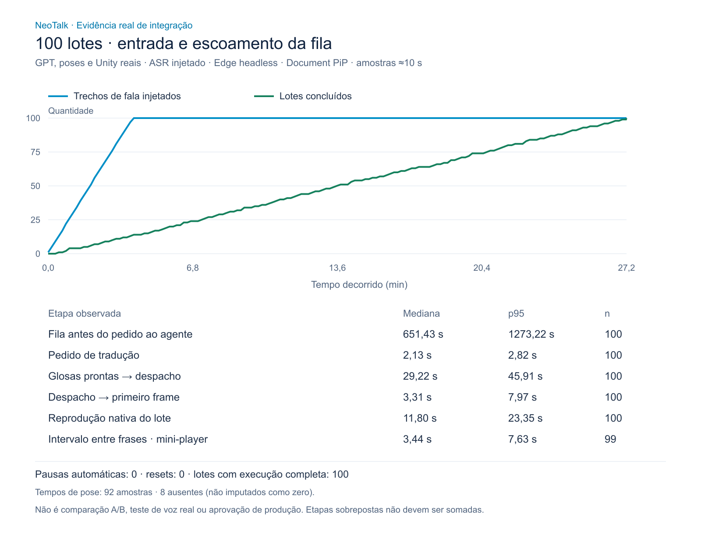

# Integração real — 23/10/2026

## Resultado e decisão

**Continuidade observada; velocidade ainda reprovada. Sem merge ou deploy.**
100 lotes (700 palavras sintéticas) chegaram ao último frame tanto na saída
principal quanto no Document Picture-in-Picture nativo. Não houve pausa
automática da captura, rejeição de entrada, lote pulado ou reinicialização do
runtime. Porém, a entrada levou aproximadamente 3min57s e o escoamento completo
27min13,5s, com pico de 85 lotes pendentes. Isso não atende a uma apresentação
fluida. Não há comparação A/B nem ganho de velocidade aprovado.

O resultado original do harness de 100 lotes é **FAIL**, preservado: faltavam
tempos de pose em oito lotes. A análise independente confirma 100 execuções
completas nas duas saídas, mas não aprova cobertura diagnóstica integral. Os
oito valores ausentes continuam ausentes; não foram preenchidos com zero nem
retroativamente classificados como cache.



[Agregados recalculados](analysis.json) · [SVG](real-queue.svg)

## Método e população

- Plataforma, banco e widget candidatos locais, isolados de produção; GPT e
  serviço NeoTalk reais. Nenhuma resposta HTTP substituída.
- Edge 155.0.4283.62 headless, duas instâncias Unity reais, PiP nativo real.
- Reconhecimento controlado: dez frases distintas de sete palavras, repetidas
  dez vezes, alvo de 180 palavras/minuto; dispositivo de áudio falso somente
  para permissão. Não representa voz/microfone/ASR físicos.
- Marcos de primeiro e último frame recebidos dos callbacks nativos de cada
  saída; ACK de carregamento não conta como execução. Texto persistido foi
  conferido em ordem pelo harness antes de encerrar a sala local criada.
- Entrada observada: 237.042,9 ms; duração até conclusão: 1.633.502 ms.
- 100 traduções HTTP 200; 92 submissões de pose HTTP 202; 160 polls HTTP 202,
  92 polls HTTP 200; 164 heartbeats HTTP 204. Nenhum erro nessas etapas registrado.
- Cache de contexto: 95 hits / 5 misses. População mista, insuficiente para
  comparar frio/quente. Todos os trechos têm o mesmo tamanho de entrada.
- Máquina com pressão de memória; inicialmente ~2,98 GiB físicos disponíveis,
  observados ~0,45 GiB com os dois renderizadores. GPU efetiva não inventariada;
  havia permissão para SwiftShader, o que não prova qual renderer foi escolhido.

## Tempos observados

| Etapa | Média | Mediana | p95 | n |
|---|---:|---:|---:|---:|
| Espera admissão → pedido ao agente | 661,37 s | 651,43 s | 1.273,22 s | 100 |
| Pedido de tradução | 2,18 s | 2,13 s | 2,82 s | 100 |
| Glosas prontas → despacho | 29,92 s | 29,22 s | 45,91 s | 100 |
| Despacho → primeiro frame principal | 3,60 s | 3,31 s | 7,97 s | 100 |
| Reprodução nativa principal | 12,65 s | 11,80 s | 23,35 s | 100 |
| Último frame → próximo primeiro frame, PiP | 3,59 s | 3,44 s | 7,63 s | 99 |
| Pipeline de pose reportado | 6,65 s | 6,64 s | 9,12 s | 92 |

Etapas se sobrepõem: **não somar médias/percentis para inferir custo total**.
O pedido de tradução inclui transporte; o provedor GPT reportou média 2,04 s.
Contexto e validação do backend tiveram médias ~0,55 ms e ~0,02 ms, não sendo
explicação suficiente para a cauda observada nesta população.

No pipeline de pose, médias: submit 1,19 s, soma das requisições de polling
4,70 s, espera de polling 0,76 s; download API→proxy 1,62 s e validação/persistência
0,30 s. São medidas sobrepostas e não separam fila/computação internas do worker.
ACK→primeiro frame observado: principal mediana 2,93 s/p95 6,72 s; PiP 2,82 s/6,16 s.
Isso inclui agendamento/postMessage; **não é CPU Unity isolada**.

## Correções preparadas e verificações adicionais

1. **Qualidade:** removido reenvio de `neotalk:sign` por estimativa de duração;
   o clip já carregado usa loop nativo. Nova comparação pausa a anterior. Troca
   de avatar espera `ready` real, não um temporizador arbitrário de 700 ms.
   Teste de navegador real observou duas voltas completas, uma submissão de pose,
   um carregamento, um ready e nenhuma exceção de página. Não audita cada frame GPU.
2. **Proveniência:** relatório distingue consulta ao serviço e replay em memória.
   Spans da mesma consulta, reaproveitados por outro lote, não viram nova amostra.
   Ensaio intermediário revelou quatro amostras para três submits e foi rejeitado
   como prova de contagem. Após correção, novo ensaio de cinco lotes passou:
   **dois submits reais, duas amostras, três replays**, cinco primeiros/últimos
   frames em cada saída, zero pausa/reset/rejeição, 103,266 s. Tempos de pose
   ausentes nos três replays continuam ausentes, mas não são requisições perdidas.
   Essa população repetida não é comparável aos 100 lotes para provar velocidade.
3. **137 testes Node passaram** após rebuild local da candidata; incluem regressões
   de loop, prontidão de avatar, atribuição de spans e consistência do analisador.
   Não houve alteração de WebGL, mãos, arquivos `.pose` ou velocidade dos sinais.

## Rastreabilidade e reprodução

Harness dos 100 lotes: commit `2e92e70fc0c2d336890e379f81a9a3121c1fa0aa`,
SHA-256 `9c4f89a366b99007a6a8cae4429e641a4293a2b866269230dddc66136e09c14e`.
Widget: `96aaaf417dc81f0d424f1c60f1a4ce29bda1b6d2`.
Checkout não identifica por si só a imagem preexistente; imagens efetivamente
executadas nos 100 lotes:

| Serviço | Docker image SHA-256 |
|---|---|
| Plataforma | `3d7f2a1cd9af1befe47b177e4a4de46a77afb776cc88bae6f05337e788c1e14b` |
| Backend | `9753fda108a0662fa254bb036d44ff49d298f2960d80352df603e1af73dfdca7` |
| Avatar | `b7cccd47f85dc4237b9a02319e97ee8259abe58fd5a8455a2133b98459ef3c6b` |

WebGL existente: manifest de 08/10/2026, Unity 6000.2.2f1, capacidade
`native-playback-progress`. Não foi recompilado. Plataforma do ensaio final de
cinco lotes: `442cc21061331a041836bbc71f8ba673931316f3b5a832b890331cf137fac07d`.

Relatórios brutos privados, sem Git: `outputs/real-services-1792779969834`,
`outputs/real-services-1792782532102` e
`outputs/quality-native-loop-1792781725793`. Agregados publicados não contêm
áudio, transcrição, credenciais ou IDs de usuário/sessão.

Após configurar o ambiente conforme [homologação local](../../HOMOLOGACAO_LOCAL.md):

```powershell
$env:QA_TRANSCRIPTS='100'
$env:QA_MAX_SECONDS='2400'
node tests/real-services-browser.cjs
node scripts/analyze-real-services.mjs outputs/real-services-<timestamp> 100
node scripts/render-real-services-evidence.mjs outputs/real-services-<timestamp>
node tests/quality-loop-browser.cjs
```

O harness atual inclui proveniência corrigida; para reproduzir o gate antigo,
usar o harness pinado acima e a imagem correspondente. Analisador retorna falha
quando a amostra é incompleta, mesmo havendo execuções concluídas.

## Próximos gates do Trello

- OBS-01 continua **Em andamento**: estratificar tamanhos e caches; inventariar
  builds de produção/hardware; separar fila/computação internas do worker.
- QUEUE-06b: continuidade observada por 27 minutos neste ensaio, não aprovação
  de velocidade, limites de memória ou voz real. Priorizar redução da cauda e
  handoff/preparação com comparação controlada da mesma carga.
- Faltam voz/ASR físicos, sessão de uma hora ou mais, minimização/background,
  outros navegadores/dispositivos, correção linguística e ensaios de falhas reais.
- PRs candidatos permanecem sem merge/deploy. Não converter este teste em
  afirmação de suporte geral ou de que a fila nunca poderá travar.
