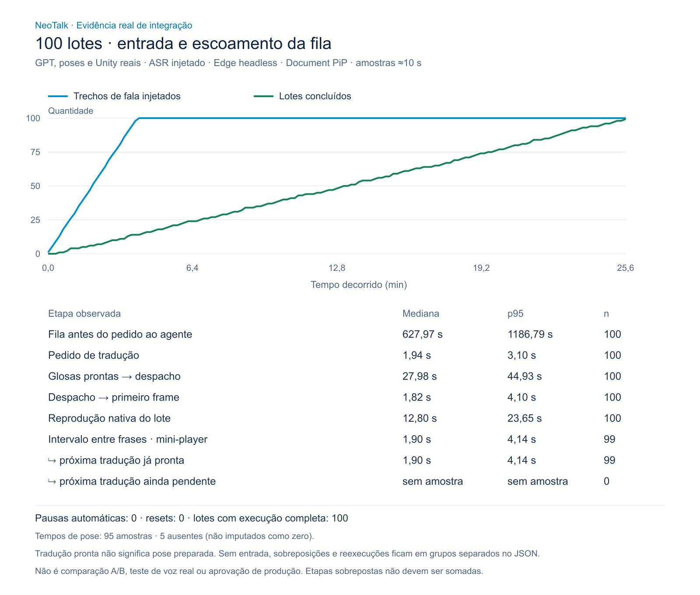

# Continuidade, pressão e captura — 27/10/2026

Subentrega local da candidata; sem merge/deploy, alteração de Unity/WebGL,
velocidade dos sinais, modelo de voz, idioma ou limites de memória da sala.

## Bateria de 100 lotes: continuidade aprovada no cenário, velocidade reprovada

**100/100 lotes concluídos no principal e no Document PiP nativo**, com primeiro
e último frame observados em cada saída e texto persistido conferido em ordem.
Zero reset/reinicialização, pausa automática de captura, rejeição de entrada,
erro, skip, cancelamento ou pendência final. O gate independente de 100 amostras,
execução e cobertura diagnóstica passou integralmente. A sala local foi encerrada.

Isso **não atende a uma palestra fluida**: 700 palavras entraram em 234,661 s
(3min54,7s); o escoamento completo terminou em **1.534,579 s (25min34,6s)**.
Pico de 85 lotes pendentes e aproximadamente 21min40s até eliminar o atraso
depois de acabar a entrada. Não há autorização para chamar isso de baixa latência.



[Relatório sanitizado e imagens efetivas](signaling-100.json) ·
[Análise recalculada](analysis.json) · [Gráfico vetorial](real-queue.svg).

| Etapa observada | Mediana | p95 | n |
|---|---:|---:|---:|
| Fila antes do pedido ao agente | 627,967 s | 1.186,786 s | 100 |
| Pedido de tradução | 1,935 s | 3,096 s | 100 |
| Glosas prontas → despacho | 27,985 s | 44,925 s | 100 |
| Despacho → primeiro frame principal | 1,818 s | 4,104 s | 100 |
| Reprodução nativa do lote | 12,804 s | 23,649 s | 100 |
| Último frame → próximo primeiro frame PiP | 1,899 s | 4,139 s | 99 |
| Pipeline de consulta de pose | 5,309 s | 7,174 s | 95 |

Nas **99 transições**, a próxima tradução já estava pronta ao chegar o último
frame anterior. Portanto, a espera do GPT **não explica essas pausas específicas**.
Preparação, despacho e agendamento do avatar ainda precisam melhorar. Os dois
players tiveram defasagem de primeiro callback mediana 50,7 ms/p95 137,3 ms;
o PiP confirmou o fim depois do principal em 87 lotes, com atraso mediano de
84,1 ms/p95 161,6 ms nesses 87. Isso não representa um segundo custo de vários
segundos nem CPU/GPU isoladas.

Avanço observado do índice da pose: mediana 23,88/s no principal e 23,85/s no
PiP, em 100 execuções cada. Não é FPS da GPU nem prova da qualidade linguística.
A duração dos próprios clips, além da transição, limita o escoamento: remover
somente as pausas não faria este corpus acompanhar a entrada de 180 palavras/min.
Não se acelerou/cortou o último sinal, eliminou trabalho aceito ou inventou
conclusão para produzir números melhores.

95 submissões de pose e 95 amostras de serviço; cinco replays com proveniência
explícita de memória do navegador, sem nova consulta. Os cinco spans ausentes
nesses replays continuam ausentes; não são tempos de serviço zero. Zero span
obrigatório desconhecido. HTTP observado: 100 traduções 200, 95 submits 202,
307 polls 202, 95 polls 200 e 155 heartbeats 204, sem erro nessas etapas.

### População, execução e limites

- Dez frases de sete palavras, repetidas dez vezes; alvo de 180 palavras/min.
  Mesmo hash de corpus da rodada de 23/10:
  `0fd389982bc2f98ec0f81866b40cf9e1e79d3d43aa0bfecd1fe9721df8c8f52e`.
- GPT, NeoTalk, plataforma/banco locais e dois Unity reais; sem HTTP substituído.
  ASR final pt-BR injetado e dispositivo sintético apenas para permissão.
  Não é acústica/voz física. Edge 155 headless, principal visível e PiP nativo;
  sem flags para desativar throttling de background. Não testa minimização.
- 95 hits/5 misses no contexto; saída GPT, caches e poses podem variar.
  Há pressão de recursos e ensaios de captura/runner concorrentes no host.
  Windows observado com 874 MB disponíveis e 98% do limite de commit.
- O histórico de 23/10 tinha pausa PiP mediana de 3,441 s e término em
  27min13,5s. A diferença atual é **observacional**, não aprovação causal/A/B:
  builds, caches, saída do modelo e pressão da máquina não foram controlados.
  Não anunciar percentual de ganho. A velocidade continua reprovada.
- Runtime identificado pelas imagens Docker do JSON, não apenas pelo checkout:
  plataforma `6eba1bb4…`, API `1079556d…`, avatar `0d1428f3…`.
  Plataforma-base do checkout `5119b5c`; widget `e3d8d5e`.
  Harness SHA-256 `6d92bfd7670c7ada8b0b264e663cbc5276050e5c92f6ad63c270ff26a91a46b1`.
  Relatório privado preservado: `outputs/real-services-1793124487029`.
- A primeira tentativa nem chegou à aplicação, pois Docker ainda inicializava;
  `outputs/real-services-1793124443473` é falha de infraestrutura, não um teste
  de sinalização aprovado nem um reset do avatar.

Próximo gate técnico: preparação **nativa** antecipada da próxima pose com
confirmação real (não só prefetch HTTP), corpus revisado em Libras e comparação
repetida de pausas/duração sem descartar trechos. Seguem pendentes o perfil
físico e os ensaios de 60 min/2 h. QA-07 permanece em andamento.

## Captura: mute/desmute repetido

| Navegador isolado/headless | Ciclos | Verificações | ASR normal 200 | Cabeçalhos sem mídia | Erros ASR/página |
|---|---:|---:|---:|---:|---:|
| Edge 155.0.4283.62 | 24 | 61/61 | 1 | 24 | 0/0 |
| Brave / Chromium 156.0.8078.48 | 24 | 61/61 | 1 | 24 | 0/0 |

Mesma versão do harness e mesmas imagens de plataforma/API nas duas rodadas
finais. `getUserMedia`, `MediaRecorder`, faixas reais do dispositivo sintético e
requisições ao transcritor reais; nenhum transcript ou HTTP de ASR substituído.
Os controles verificam identidade do stream, mute efetivo, retomada do mesmo
stream, rotação posterior do gravador e liberação das faixas no encerramento.

O widget foi omitido explicitamente nesses ensaios **de captura**, para não
carregar um terceiro Unity durante a bateria separada de sinalização. Isso não
aprova animação, PiP, permissões do perfil pessoal, microfone físico, qualidade
de reconhecimento, supressão de ruído ou isolamento de vozes próximas. Um
`200/empty_container` é slot sem mídia liberado, não sucesso do provedor.
Também houve controle separado do cabeçalho conhecido antes de cada sala.

Agregados por allowlist, sem fala, erros livres, cookies, chaves ou IDs:
[Edge](capture-edge.json) e [Brave](capture-brave.json).
Arquivos originais privados preservados em
`outputs/capture-managed-1793125353649` e
`outputs/capture-managed-1793125172065`.

### Falhas do harness preservadas

As duas primeiras rodadas com renderizador omitido falharam na checagem de
exceções da página, embora os controles de captura/ASR passassem. A instrumentação
do teste era instalada também no iframe bloqueado de origem opaca, onde
`navigator.mediaDevices` não existe. Corrigido o observador para instrumentar
somente a janela superior da plataforma; não se removeu a checagem de exceções.
Repetições finais acima passaram com zero exceções. Falhas privadas originais:
`outputs/capture-managed-1793124965555` e
`outputs/capture-managed-1793125037198`. Não foi uma nova correção da aplicação.

Teste determinístico adicional executa **32 ciclos**, verificando cada timer
atual, todas as 33 caudas admitidas e a rejeição de callbacks após encerrar a
geração. Esse teste de closures não representa hardware/Unity reais.

## Análise das pausas

O analisador recalcula os intervalos dos pontos e callbacks brutos e agora separa:

- Próxima tradução pronta ao chegar o último frame anterior.
- Tradução da próxima entrada ainda pendente nesse momento.
- Próxima entrada ainda nem admitida (ociosidade, não tempo do GPT).
- Informação desconhecida; sobreposições e reexecuções ficam contadas à parte.

Também mede a diferença entre as duas saídas no mesmo lote, sem combinar
execuções ambíguas, e o avanço de índices de pose por segundo observado entre
callbacks. Este último não é FPS de GPU. Um retorno pronto do agente não prova
que Unity já preparou a pose; diferenças entre callbacks incluem agendamento.
Tempos sobrepostos não devem ser somados para inferir custo total.

## Reprodução

```powershell
npm run test:unit
$env:QA_CAPTURE_MUTE_CYCLES='24'
$env:QA_CAPTURE_RENDERER='omit'
$env:QA_CAPTURE_BROWSER='edge' # repetir com brave; perfil sempre temporário
node tests/capture-browser.cjs
```

Os serviços da homologação local precisam estar saudáveis. Chaves ficam somente
no arquivo privado ignorado pelo Git. Nenhuma conta/aba/permissão pessoal do
Brave foi usada pelo harness; o Trello é atualizado pela sessão já autenticada
do Brave, separadamente.

## Regressão e recursos do runner

164 testes Node passaram integralmente em execução serial; 52 testes Python
passaram. Duas tentativas concorrentes do runner Node esgotaram memória durante
a homologação (`Zone Allocation failed`, `HashMap::Initialize` e erros de heap),
inclusive antes de alguns arquivos iniciarem seus testes. Essas tentativas não
são aprovação. O comando padrão agora limita os workers de arquivo a um e mantém
todos os testes, inclusive os de pressão. Uma tentativa serial sobreposta à
carga ainda falhou por memória; o Windows chegou a 98% do limite de memória
comprometida (27,76/28,32 GB). Não é uma garantia de rodar sem RAM disponível.
Depois de terminar a bateria e fechar o navegador de teste, `npm test` passou
novamente: build e os 164 testes, sem falhas ou skips. Isso controla os recursos do runner,
não altera a concorrência da aplicação nem aprova desempenho em produção.

Gate de evento ainda exige microfone/voz físicos, matriz completa,
minimização prolongada, 60 minutos por perfil, soak de duas horas e revisão em
Libras. Nenhum cartão pai deve ser concluído por estes ensaios de captura.
